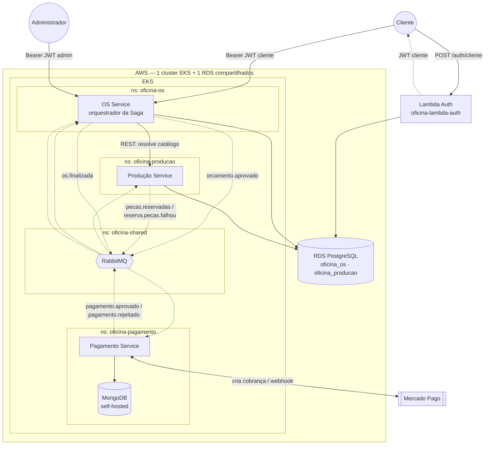
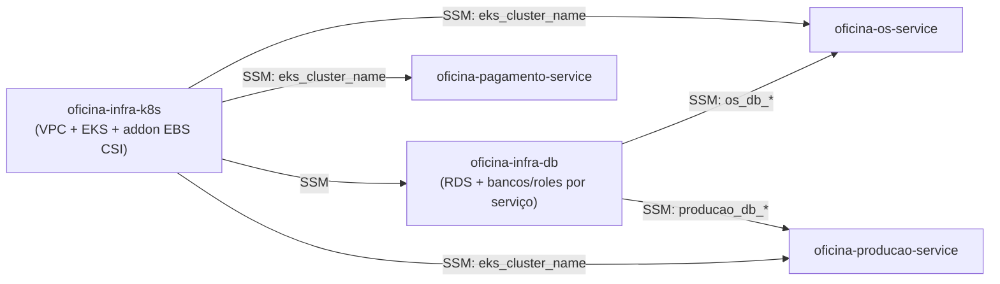

# Arquitetura — Fase 4 (Microsserviços)

## Por que microsserviços, e por que esta divisão

A Fase 3 já operava como um monolito "corporativo" (4 repositórios, nuvem real,
observabilidade), mas a aplicação em si continuava sendo uma unidade de deploy só —
`oficina-tech-challenge`. A Fase 4 exige quebrar essa unidade em **serviços
independentes**, cada um dono do seu próprio banco, comunicando-se por rede.

A divisão seguiu os limites de contexto que já existiam dentro do monolito (cada
módulo já era isolado em `domain/application/infrastructure/interfaces` — ver
[arquitetura das Fases 2/3](https://github.com/RafaelNikolasPuggi/oficina-tech-challenge/blob/main/docs/architecture.md)), em vez de desenhar uma divisão nova do zero:

| # | Serviço | Vem do monólito | Dono de | Banco | Repositório |
|---|---|---|---|---|---|
| 1 | **OS Service** | `ordens-servico` + `clientes` + `veiculos` | Agregado central (máquina de estados da OS) e **orquestrador da Saga** | PostgreSQL | [oficina-os-service](https://github.com/RafaelNikolasPuggi/oficina-os-service) |
| 2 | **Produção Service** | `pecas` + `servicos` | Catálogo e estoque | PostgreSQL | [oficina-producao-service](https://github.com/RafaelNikolasPuggi/oficina-producao-service) |
| 3 | **Pagamento Service** | *novo* | Integração Mercado Pago | MongoDB | [oficina-pagamento-service](https://github.com/RafaelNikolasPuggi/oficina-pagamento-service) |

`clientes`/`veiculos` ficaram no OS Service (em vez de um 4º serviço de cadastro) por
simplicidade: são dados de referência de baixo acoplamento, consultados só pelo
próprio agregado de OS, e o requisito mínimo da Fase 4 (≥3 serviços, SQL + NoSQL) já
é satisfeito pelos 3 acima. `oficina-lambda-auth` (Function Serverless, autenticação
de cliente por CPF) continua como estava na Fase 3 — já era um serviço isolado.

### Persistência poliglota

- **PostgreSQL** (OS e Produção): dados transacionais com relacionamentos e
  necessidade real de ACID — baixa de estoque concorrente, máquina de estados da OS.
- **MongoDB** (Pagamento): cada notificação (webhook) do Mercado Pago tem formato
  ligeiramente diferente dependendo do tipo de evento, e o histórico bruto de cada
  pagamento precisa ser preservado para auditoria sem forçar um schema rígido — um
  documento por pagamento, com o histórico de eventos embutido, se encaixa melhor
  aqui do que uma tabela relacional normalizada.

**Nenhum serviço acessa o banco de outro diretamente.** OS Service resolve
nome/preço do catálogo via **REST síncrono** no Produção Service (consulta, não
mutação); toda coordenação que envolve mudança de estado entre serviços passa pela
Saga assíncrona abaixo.

## Infraestrutura compartilhada (decisão de custo)

Em vez de 3 clusters EKS + 3 instâncias RDS (triplicaria o custo da Fase 3), os 3
serviços compartilham:
- **1 cluster EKS** (`oficina-infra-k8s`) — cada serviço no seu próprio namespace
  (`oficina-os`, `oficina-producao`, `oficina-pagamento`), mais um namespace
  `oficina-shared` para o RabbitMQ.
- **1 instância RDS PostgreSQL** (`oficina-infra-db`) — bancos lógicos e *roles*
  próprias para OS e Produção (nunca o usuário mestre, nenhum dos dois acessa o banco
  do outro).
- **MongoDB** e **RabbitMQ** self-hosted no próprio cluster (não um serviço
  gerenciado adicional) — mesma filosofia "custo mínimo" do RDS single-AZ da Fase 3.

Cada repositório também tem sua **própria infraestrutura local** (`/infra`,
cluster `kind` efêmero) validada de graça a cada push no CI — ver o `ci.yml` de cada
serviço.



## Saga (orquestrada) — aprovação, execução e pagamento

**Escolha: orquestrada, com o OS Service como orquestrador.** A OS já é uma máquina
de estados central no domínio (`RECEBIDA → EM_DIAGNOSTICO → AGUARDANDO_APROVACAO →
EM_EXECUCAO → FINALIZADA → ENTREGUE`) — colocar a orquestração ali evita duplicar
lógica de estado em cada serviço, e concentra num único lugar tanto o fluxo feliz
quanto as compensações, o que facilita depurar e demonstrar.

```mermaid
sequenceDiagram
    participant Cliente
    participant OS as OS Service
    participant MQ as RabbitMQ
    participant PROD as Produção Service
    participant PAG as Pagamento Service
    participant MP as Mercado Pago

    Cliente->>OS: POST /ordens-servico/:id/aprovacao
    OS->>MQ: emit orcamento.aprovado
    Note over OS: OS permanece AGUARDANDO_APROVACAO

    MQ->>PROD: orcamento.aprovado
    alt estoque suficiente
        PROD->>PROD: decrementarEstoqueTransacional
        PROD->>MQ: emit pecas.reservadas
        MQ->>OS: pecas.reservadas
        OS->>OS: transiciona para EM_EXECUCAO
    else falta de estoque (compensação)
        PROD->>MQ: emit reserva.pecas.falhou {pecaNome, disponivel, solicitado}
        MQ->>OS: reserva.pecas.falhou
        OS->>OS: permanece AGUARDANDO_APROVACAO
        OS->>Cliente: e-mail — estoque insuficiente
    end

    Note over OS: execução acontece normalmente
    OS->>OS: finalizar() → FINALIZADA
    OS->>MQ: emit os.finalizada {ordemServicoId, clienteId, valor}
    MQ->>PAG: os.finalizada
    PAG->>MP: cria preferência de pagamento
    PAG->>Cliente: (Mercado Pago) checkout

    MP->>PAG: webhook (notificação assíncrona)
    PAG->>MP: reconsulta o pagamento (nunca confia só no corpo do webhook)
    alt pagamento aprovado
        PAG->>MQ: emit pagamento.aprovado
        MQ->>OS: pagamento.aprovado
        OS->>OS: confirmarPagamento() — libera entregar()
    else pagamento rejeitado (compensação)
        PAG->>MQ: emit pagamento.rejeitado
        MQ->>OS: pagamento.rejeitado
        Note over OS: permanece FINALIZADA — serviço já executado,<br/>nada pra desfazer fisicamente; bloqueado pra entrega
        OS->>Cliente: e-mail — tentar pagamento de novo
    end
```

Dois pontos de compensação reais:
1. **Falta de estoque** — nada foi reservado ainda, então a compensação é simplesmente
   não avançar o estado (a OS permanece `AGUARDANDO_APROVACAO`) e notificar.
2. **Pagamento rejeitado** — o serviço já foi executado fisicamente, então não há o
   que desfazer; a compensação é bloquear a transição final (`entregar()`) até uma
   nova tentativa de cobrança ser aprovada.

Cobertura de teste do fluxo completo (sucesso + as 2 compensações): BDD em
[`test/features/saga-ordem-servico.feature`](../test/features/saga-ordem-servico.feature).

## Dependências entre repositórios


